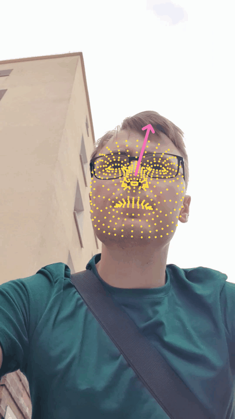
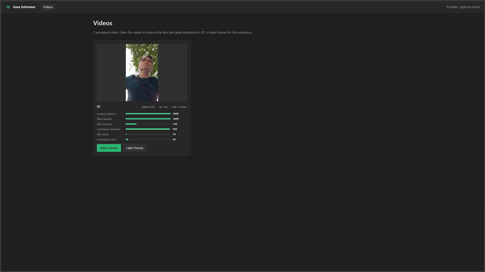
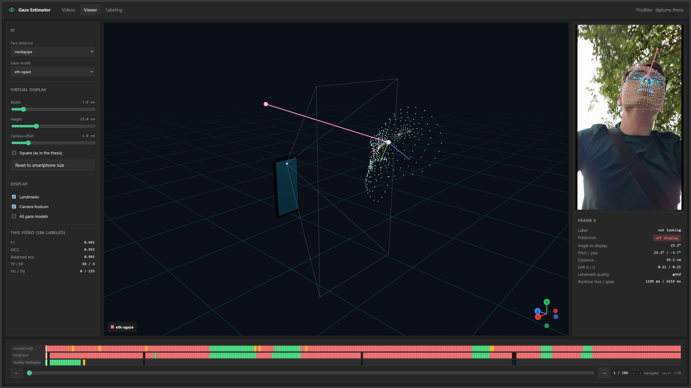
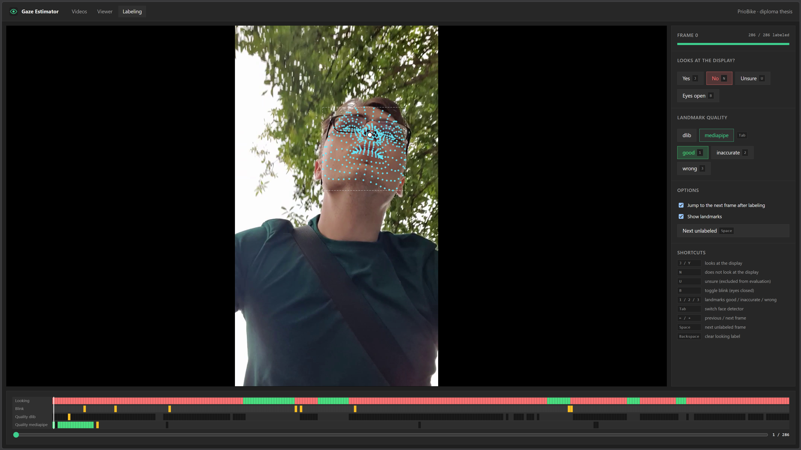
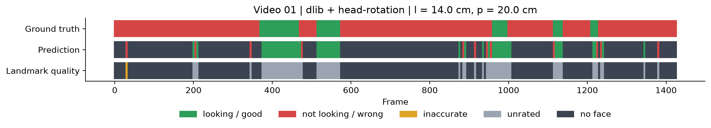

# Diploma Thesis: Conception and Evaluation of a Smartphone-based Eye-Tracking Solution for Use in Bicycle Rides with High Robustness against Changing Environmental Conditions

> [!NOTE]
> **This repository was reworked in 2026, long after the thesis was submitted.** The code you see here is a cleaned-up and extended version, not the code the thesis results are based on:
>
> - The pipeline was rebuilt as an installable Python package with three entry points: a live demo, batch processing of videos, and the evaluation. Results go into a SQLite database.
> - The Angular/Express tools were replaced by a single React + three.js app that combines the 3D viewer and the labeling tool.
> - The evaluation reproduces the method of the thesis and its graphs. It adds leave-one-video-out cross-validation, an angle-based score with ROC/PR curves, MCC and balanced accuracy, and temporal smoothing (see [Method and its limitations](#-method-and-its-limitations)).
>
> The version submitted with the thesis (December 4th, 2023) is commit [b3adb41](https://github.com/SoWieMarkus/diploma-thesis/tree/b3adb4154be1305a319b566e065639df9ee3277a).

> [!NOTE]
> The thesis itself ([thesis.pdf](./thesis.pdf), LaTeX sources in [thesis/](./thesis)) is written in German.

This repository contains the implementation and documentation of my diploma thesis, submitted at the Technical University of Dresden (Technische Universität Dresden) as part of the [PrioBike](https://www.flow-d.de/projekte/priobike-hh-unterauftrag-der-tu-dresden/) project of the city of Hamburg. It is a smartphone-based eye-tracking system for cyclists. It measures how often the cyclist looks at the smartphone, and so how much a navigation app distracts them.

## Screenshots

> [!WARNING]
> I was young and stupid and did not wear a helmet during the test rides. Please don't copy that: **always wear a helmet when you ride a bike.**







## How it works

1. **Face detection**: [MediaPipe](https://ai.google.dev/edge/mediapipe/solutions/vision/face_landmarker) (468 landmarks) or [dlib](http://dlib.net/) (68 landmarks).
2. **Head pose**: a generic 3D face model is fitted to the landmarks (`solvePnP`). This gives the face position in camera coordinates and the head rotation.
3. **Gaze estimation**: the face image is normalized ([Zhang et al. 2018](https://dl.acm.org/doi/10.1145/3204493.3204548)) and fed into a CNN that predicts pitch and yaw:
   - `eth-xgaze`: ResNet-18 trained on [ETH-XGaze](https://ait.ethz.ch/xgaze)
   - `l2cs-gaze360`: [L2CS-Net](https://github.com/Ahmednull/L2CS-Net) trained on Gaze360
   - `mpiifacegaze`: ResNet trained on [MPIIFaceGaze](https://www.mpi-inf.mpg.de/departments/computer-vision-and-machine-learning/research/gaze-based-human-computer-interaction/its-written-all-over-your-face-full-face-appearance-based-gaze-estimation)
   - `head-rotation`: baseline that assumes the gaze follows the head
4. **Looking at the display?** The smartphone films with its front camera, so its display lies in the camera plane `z = 0`. The gaze ray from the face center is intersected with that plane. A hit on a virtual display rectangle counts as "looking at the smartphone".

## Setup

Requirements: [uv](https://docs.astral.sh/uv/) and, for the web app, [Node.js](https://nodejs.org/) 22+ with [pnpm](https://pnpm.io/).

```bash
# CPU version of PyTorch (use --extra cu128 instead for an NVIDIA GPU)
uv sync --extra cpu

# Optional: the dlib face detector. dlib is compiled from source, which needs CMake and a C++
# compiler (on Windows the Visual Studio Build Tools) and takes a while.
uv sync --extra cpu --extra dlib

# Download the model weights that are missing in data/assets (see data/assets/README.md)
uv run gaze-download-assets
```

Without the `dlib` extra, everything works except the `dlib` face detector. Choose the others explicitly, e.g. `--faces mediapipe`.

## 1. Live demo

Opens the webcam and draws landmarks, head axes, the gaze vector and a "looking at display" indicator.

```bash
uv run gaze-demo --face mediapipe --gaze eth-xgaze
uv run gaze-demo --face dlib --gaze l2cs-gaze360 --camera 1 --mirror
```

| Option                       | Description                                                                          |
| ---------------------------- | ------------------------------------------------------------------------------------ |
| `--face`                     | `mediapipe` or `dlib`                                                                |
| `--gaze`                     | `eth-xgaze`, `l2cs-gaze360`, `mpiifacegaze` or `head-rotation`                       |
| `--camera`                   | camera index or path of a video file                                                 |
| `--profile`                  | camera intrinsics, see [camera.example.yaml](./camera.example.yaml)                  |
| `--display W H OFFSET`       | virtual display in meters for the indicator (default: `0.07 0.15 0.01`)             |
| `--mirror`                   | mirror the preview                                                                    |

Keys: `q` quits, `l` toggles the landmarks.

## 2. Process videos

Put the videos into `data/input/`, then run:

```bash
uv run gaze-process --step 5
```

Every `--step`-th frame is saved as a JPG in `data/output/<video>/` and analyzed with **every face detector and every gaze model**. The results (landmarks, 3D head pose, gaze vectors, runtimes, image statistics) are stored in `data/gaze.db`. The command can be resumed: running it again only computes what is missing (new videos, new models, a smaller step). `--faces` and `--gazes` restrict the models, and `--force` recomputes them.

## 3. View and label

```bash
uv run gaze-serve                 # API on http://127.0.0.1:8000
cd web && pnpm install && pnpm dev   # web app on http://localhost:5173
```

Alternatively, run `pnpm build` once in `web/`. After that, `gaze-serve` also hosts the app on port 8000.

- **Viewer**: a 3D scene with the camera, the virtual smartphone display, the face point cloud, the head axes and the gaze rays of all models. Next to it is the frame with the landmarks drawn on top, plus a timeline of ground truth and prediction. Display size and offset can be tuned with sliders. F1, MCC and balanced accuracy of the current video update live.
- **Labeling**: keyboard driven.
  - `J`/`N`/`U`: looking at the display, not looking, unsure.
  - `B`: blink.
  - `1`/`2`/`3`: landmark quality (good, inaccurate, wrong) for each face detector. `Tab` switches the detector.
  - `Space` jumps to the next unlabeled frame.

| Label           | Values                                                                 |
| --------------- | ---------------------------------------------------------------------- |
| `label_looking` | `0` not looking, `1` looking, `2` unsure (excluded from the evaluation) |
| `label_blink`   | `true` eyes closed, `false` eyes open                                  |
| `label_quality` | `0` good, `1` inaccurate, `2` wrong (per face detector)                |

## 4. Evaluate

```bash
uv run gaze-evaluate --config eval.yaml   # config optional, see eval.example.yaml
```

Graphs (PNG + PDF) and tables (CSV + LaTeX) are written to `data/plots/`:

| Folder              | Content                                                                                                     |
| ------------------- | ----------------------------------------------------------------------------------------------------------- |
| `grid/`             | F1 heatmaps over display size `l` and offset `p` (per video and averaged), F1 vs. display size *(thesis)*   |
| `timelines/`        | strips of ground truth / prediction / landmark quality per video and model *(thesis)*                       |
| `faces/`            | landmark quality bars; distance, brightness, contrast and sharpness per frame; distance histogram *(thesis)* |
| `blinks/`           | F1 of blink detection vs. EAR threshold *(thesis)*                                                           |
| `angle/`            | ROC and precision-recall curves of the angle-to-display score, angle distributions                         |
| `cross_validation/` | leave-one-video-out F1/MCC per held-out video, confusion matrices, effect of temporal smoothing             |
| `summary/`          | comparison of all face detector + gaze model combinations                                                  |
| `tables/`           | `summary`, `cross_validation_folds`, `face_detection`, `blinks`                                            |



## Method and its limitations

What the rework changes, and what is still a limitation:

1. **Overfitting of the display parameters.** In the thesis, the size and offset of the virtual display were chosen by a grid search on the same videos the F1 score was reported for. Some videos were also left out after looking at the results. Both make the reported F1 optimistic. `gaze-evaluate` still reproduces the thesis numbers (`thesis_f1`). It also reports **leave-one-video-out cross-validation** (`cv_*`): the parameters are tuned on all other videos and tested on the held-out one. Excluded videos have to be listed in the config together with a reason.
2. **A hard hit/miss decision hides how good a model is.** The **angle between the gaze ray and the display** is a continuous score. It gives ROC/PR curves and AUC values, so models can be compared without choosing any threshold.
3. **Class imbalance.** Cyclists mostly do *not* look at the phone, so the F1 score alone can be misleading. MCC, balanced accuracy and confusion matrices are reported too.
4. **Camera intrinsics are guessed.** Without a calibration, the focal length is assumed to be the image width, as in the thesis. This affects the estimated distance and therefore where the gaze ray meets the camera plane. Calibrated intrinsics (or at least the field of view) can be passed as a camera profile.
5. **Frames are judged independently.** A glance at the phone lasts several frames, so an optional temporal majority filter is evaluated as a separate variant.
6. **Remaining limitations.**
   - The models were trained on people sitting in front of a camera, not on cyclists filmed from below.
   - Sunglasses, night rides and extreme head rotations remain hard.
   - The display is assumed to lie in the camera plane (front camera, phone held upright).

## Development

```bash
uv sync --extra cpu --group dev
uv run pytest
uv run ruff check . && uv run ruff format .

cd web
pnpm lint && pnpm format && pnpm build
```

The CI (`.github/workflows/ci.yml`) runs the same checks. It skips dlib, because building it takes ages and its tests are skipped when it is missing.

Environment variables: `GAZE_DATA_DIR`, `GAZE_ASSETS_DIR`, `GAZE_DATABASE` (default locations) and `GAZE_DEVICE` (e.g. `cpu` to force the CPU).

## Repository structure

| Path                               | Content                                                                    |
| ---------------------------------- | -------------------------------------------------------------------------- |
| `gaze_estimator/core/`             | camera intrinsics, geometry (gaze vectors, display intersection, angles)  |
| `gaze_estimator/faces/`            | face detectors and head pose estimation                                    |
| `gaze_estimator/gaze/`             | gaze models                                                                |
| `gaze_estimator/db/`               | SQLite schema (SQLModel)                                                   |
| `gaze_estimator/pipeline/`         | batch processing of videos                                                 |
| `gaze_estimator/evaluation/`       | grid search, cross-validation, metrics, graphs, tables                     |
| `gaze_estimator/api/`              | FastAPI backend of the web app                                             |
| `gaze_estimator/cli/`              | entry points (`gaze-demo`, `gaze-process`, `gaze-serve`, `gaze-evaluate`)  |
| `web/`                             | React + three.js viewer and labeling tool                                  |
| `data/assets/`                     | model weights and 3D face templates                                        |
| `data/input/`, `data/output/`      | your videos and the extracted frames                                       |
| `thesis/`, `thesis.pdf`            | the thesis (German)                                                        |

## Abstract

The climate crisis represents one of the greatest challenges of our time, with urban traffic being a major contributor through high CO2 and particulate matter emissions. To address this issue, the city of Hamburg initiated the PrioBike project, which aims to make cycling more attractive and revolutionary through optimized navigation apps that provide speed recommendations based on traffic light data.

However, smartphone usage while cycling poses significant safety risks due to potential distractions. This thesis investigates the feasibility of smartphone-based eye-tracking solutions to monitor when cyclists look at their devices, enabling the identification of distracting app interfaces and evaluation of alternative interaction methods. The work aimed to develop and evaluate a robust smartphone-based eye-tracking system for cyclists that operates using only the front-facing camera, without additional hardware or calibration requirements, while maintaining high robustness against changing environmental conditions.

Various gaze estimation approaches were investigated, including deep learning appearance-based methods and head rotation-based techniques. Face detection was performed using MediaPipe and dlib, followed by 3D gaze direction estimation using convolutional neural networks trained on ETH-XGaze, Gaze360, and MPIIFaceGaze datasets. The system determines whether cyclists are looking at their smartphone display by modeling a detection zone on the camera plane.

The best performance was achieved using MediaPipe for face detection combined with ETH-XGaze for gaze estimation, reaching an F1-score of 0.928. The system successfully compensated for normal environmental influences including vibrations and varying lighting conditions. However, challenges were identified with sunglasses, night recordings, and extreme head rotations.

The developed system demonstrates that smartphone-based eye-tracking for cyclists is feasible and can effectively determine when users look at their devices. The solution is robust against typical cycling conditions and provides a cost-effective approach for evaluating app interfaces and interaction methods in real-world cycling scenarios. This work contributes significantly to the safe usage of navigation apps while cycling and provides a foundation for future studies within the PrioBike project.
